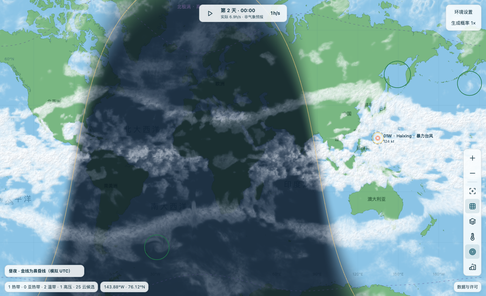
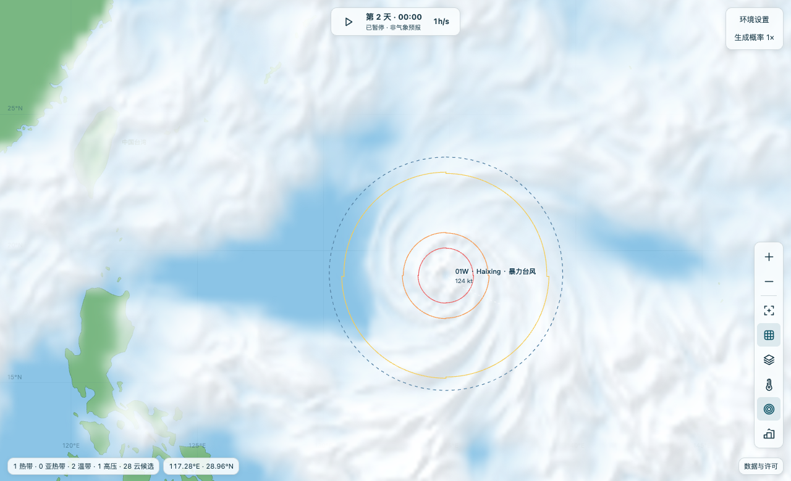
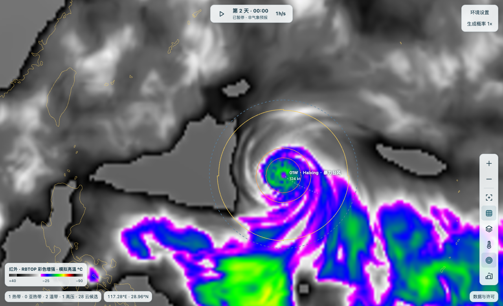

# 台风模拟器 · 简洁版

一个在浏览器本地运行的全球热带气旋模拟器。生成扰动，观察云团组织成风暴，比较云水、对流、红外和昼夜图层，也可以接管单个风暴的行进方向。天气由简化模型生成，不是实况资料或专业预报。

地图、地形、可读的 JavaScript 源码和 WebAssembly 云物理内核都已包含；运行不需要 API 密钥、npm 安装或商业 SDK。

左键拖动平移，单击空白处打开生成菜单，单击气旋查看数据；滚轮／双指缩放。「地图显示类型 → 昼夜」按模拟 UTC 显示晨昏线，白天显示可见光云水，夜间显示模拟热红外。

### 截图演示

[](docs/screenshots/day-night.png)

同一模拟时刻、同一视角：左图显示西北太平洋示例气旋的**云水和风圈**，右图切换为 **RBTOP 增强红外**。颜色反映模拟亮温，不代表风速。三图均为简洁版实截，非实况卫星图；点击图片可看原图。

| 云水与风圈 | RBTOP 红外 |
| :--: | :--: |
| [](docs/screenshots/cyclone.png) | [](docs/screenshots/infrared.png) |

### 一键启动

先克隆仓库或下载 ZIP **并完整解压**。需要 Python 3.8 或更新版本，无需安装第三方包。

| 系统 | 启动方式 |
| --- | --- |
| macOS | 双击 [Start-macOS.command](Start-macOS.command)，或在仓库目录执行 `sh Start-macOS.command`。 |
| Windows | 双击 [Start-Windows.cmd](Start-Windows.cmd)。 |

启动后自动打开默认浏览器，只监听 `127.0.0.1`。默认端口为 8786；如已占用，终端会显示新端口。按 **Ctrl+C** 停止。手动启动：

```sh
python3 tools/serve.py
```

只启动服务而不打开浏览器时，加 `--no-browser`。也可以将 `dist/` 部署到静态服务器。请不要直接双击 HTML：浏览器需要通过 HTTP 加载模块和 Worker。

### 开发

- `dist/` 直接包含网页和未压缩的 JS 源码。用 Node.js 22 或更高版本运行 `node --test tests/*.test.mjs`，无需安装依赖。
- `native-web/cloud_kernel.c` 和 `physics/*.generated.h` 是预编译 WebAssembly 的构建输入。安装带 wasm32 目标的 Clang 和 wasm-ld 后执行 `sh tools/build-cloud-kernel.sh`；可用 `CLANG` 和 `WASM_LD` 指定路径。
- `physics/*.flaq` 是风眼、海面和气压方程，同时附有可编辑的 C/JS 实现；构建已提供的 WASM 不需要 FlaqSDK。
- 原始海岸线的转换方法见[地图数据说明](dist/data/README.md)。重建地形使用 `node tools/build-terrain.mjs` 和 `node tools/build-taiwan-terrain.mjs`，仅此步骤需要 `sharp`（`npm install --no-save --package-lock=false sharp`）。气候格点生成器及其输入见 [build-climate.py](tools/build-climate.py)。

### 许可证和数据

本项目的原创程序按 [GNU Affero General Public License, version 3 only](LICENSE)（`AGPL-3.0-only`）发布。第三方海岸线、高程和气候资料不因打包在此而改换许可证；详见[数据来源与署名](dist/credits.html)和[地形提供方完整说明](dist/data/terrain-attribution.md)。

### 命名与洋区环境

地图、详情、登陆记录和排行榜使用同一系统编号。扰动使用本洋区的 90–99 号；达到模拟的热带低压认定条件后，使用该季正式序号（如 01W、02C）。模拟按后缀分别计数，地中海 M 为本项目扩展，不是官方编号。随机初始环流半径是 70–800 km；手动仍可调 70–2600 km。

热带或亚热带系统首次达到模拟的 1 分钟持续风 **34 kt** 时，从所在洋区的 180 个英文或罗马字拼写中随机抽取一个；同场活跃系统不同名。跨洋区、减弱和转性不会让它改名。11 个名单是本模拟器的创作，并非 [WMO 官方命名表](https://wmo.int/content/tropical-cyclone-naming)。

海温和深层风切变取自 [NOAA PSL 的 ERSSTv5](https://downloads.psl.noaa.gov/Datasets/noaa.ersst.v5/sst.mon.ltm.1991-2020.nc) 与 [NCEP/NCAR 再分析](https://downloads.psl.noaa.gov/Datasets/ncep.reanalysis.derived/pressure/) 的 1991–2020 年月平均资料。随应用附带的 5° 网格按位置和月份插值；风切变基线是 200 与 850 hPa **月平均风矢量差的模**，不等于逐时风切变模长的平均值。模拟天气异常、季节和用户设置仍然有效；临近海岸和小岛的局地特征受分辨率限制。这不是实况或预报。
