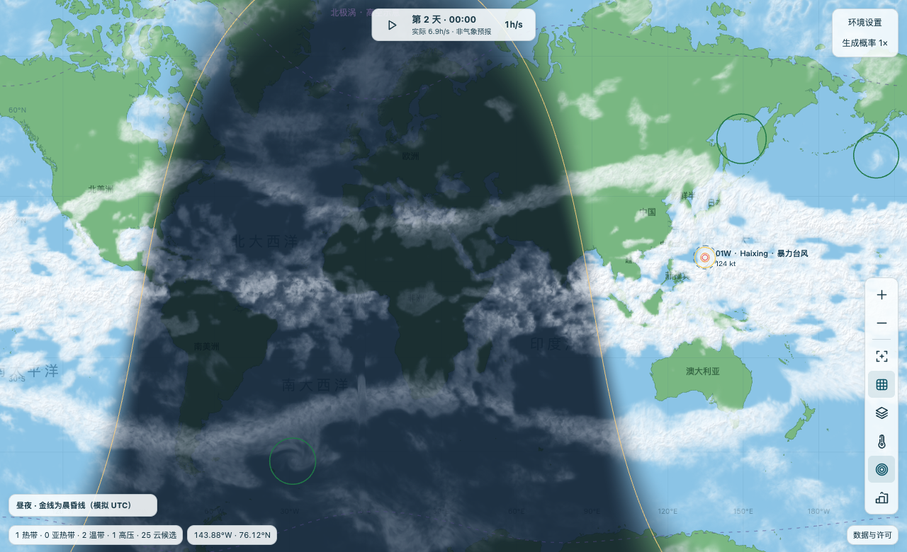
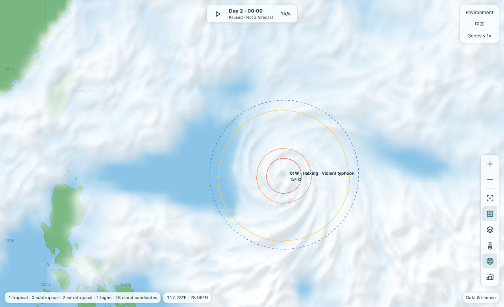
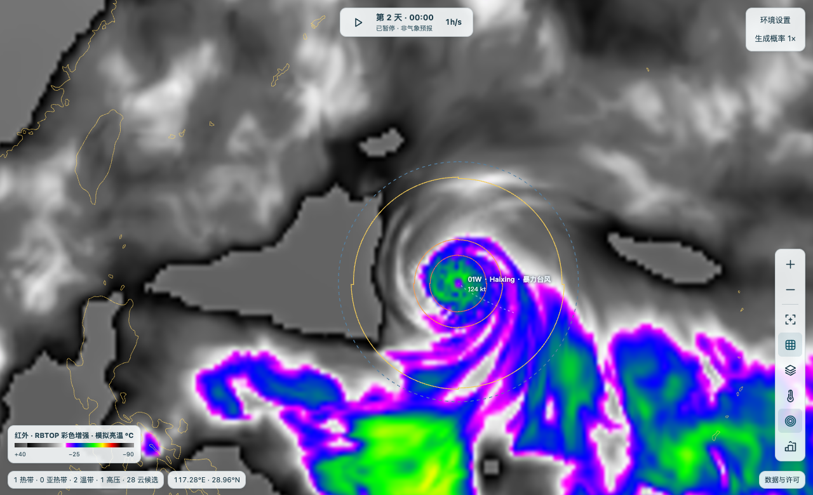
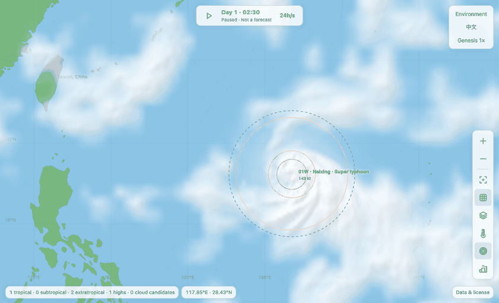

# 台风模拟器

**[在线试玩](https://bledleng.github.io/typhoon-simulator-plain/?lang=zh)** · [English](README.md) · 简体中文

首次打开默认为英语。点右上角 **中文** 可切换，之后会记住选择。也可通过 `?lang=zh` 或 `?lang=en` 指定语言。切换不会重置本局。

一个在浏览器本地运行的全球热带气旋模拟器。生成扰动，观察云团组织成风暴，比较云水、对流、红外和昼夜图层，也可以接管单个风暴的行进方向。天气由简化模型生成，不是实况资料或专业预报。

地图、地形、可读的 JavaScript 源码和 WebAssembly 云物理内核都已包含；运行不需要 API 密钥、npm 安装或商业 SDK。

左键拖动平移，单击空白处打开生成菜单，单击气旋查看数据；滚轮／双指缩放。「地图显示类型 → 昼夜」按模拟 UTC 显示晨昏线，白天显示可见光云水，夜间显示模拟热红外。

### 截图演示

[](docs/screenshots/day-night.png)

下方两图记录同一模拟时刻和视角：左图显示西北太平洋气旋的**云水和风圈**，右图是 **RBTOP 增强红外**。红外颜色反映模拟亮温，不代表风速。点击图片可看原图。

| 云水与风圈 | RBTOP 红外 |
| :--: | :--: |
| [](docs/screenshots/cyclone.png) | [](docs/screenshots/infrared.png) |

**固定视角看一场风暴的 28 个模拟小时。** 留意中心相对岛屿的位置，以及外围云带如何伸展、断开。示例从一个已经组织起来的西北太平洋涡旋开始，不代表普通扰动能在这段时间内达到同样强度。

[](docs/screenshots/storm-evolution.gif)

[打开演示图册 →](docs/gallery.md#中文) 同一时刻对照对流、气压和海面冷尾迹，再试试查看风圈、施加风切变脉冲。

### 一键启动

先克隆仓库或下载 ZIP **并完整解压**。需要 Python 3.8 或更新版本，无需安装第三方包。

| 系统 | 启动方式 |
| --- | --- |
| macOS | 双击 [Start-macOS.command](Start-macOS.command)，或在仓库目录执行 `sh Start-macOS.command`。 |
| Windows | 双击 [Start-Windows.cmd](Start-Windows.cmd)。 |

启动后自动打开默认浏览器，只监听 `127.0.0.1`。默认端口为 8786；如已占用，终端会显示新端口。按 **Ctrl+C** 停止。手动启动：

```sh
python3 tools/serve.py
```

只启动服务而不打开浏览器时，加 `--no-browser`。也可以将 `dist/` 部署到静态服务器。请不要直接双击 HTML：浏览器需要通过 HTTP 加载模块和 Worker。

### 从水汽到卫星云图，模型怎么算？

**风眼不只分「开」和「没开」。** 湿润、正在组织的风暴可由内雨带卷绕形成云卷眼，此时未必有完整圆眼。点气旋可在详情里查看当前结构。成熟系统的外眼墙可取代逐渐衰退的内墙，也可与仍有对流的内墙靠拢融合；环境变差时，外墙还可能消散。融合与常规置换分开计数，不按固定风速触发。这是参考[卫星风眼形态](https://www.jma.go.jp/jma/jma-eng/jma-center/rsmc-hp-pub-eg/techrev/text13-1.pdf)和[双眼墙观测分类](https://journals.ametsoc.org/view/journals/wefo/39/1/WAF-D-23-0047.1.xml)的参数化模拟。

1. **云不是跟着风暴走的贴图。** 全球墨卡托网格为 640 × 512，覆盖南北纬 85° 之间，经度在日界线处首尾相接。网格保存水汽、凝结水、温度和雨冷空气的状态。风搬运已有的云水，输送订正被限制在来源格点的取值范围内，避免凭空产生负值；地表蒸发补充水汽，凝结形成云，降水移走水分。活跃区域最多再分配三块 160 × 160 的细网格，从全球场取得边界条件，移动时保留重叠区域已经演化的状态。[全球湿大气](dist/cloud-field.js) · [嵌套网格](dist/cloud-detail.js)
2. **路径和加强速度不是预先写好的。** 弱扰动主要随浅层气流走；风速、暖心和组织度决定深层引导气流占多少。即使海温相同，风切变、湿度、海洋热含量和已经建立的对流也会改变加强速度。同半球两个涡旋靠近时，互相诱导的环流按约八个模拟小时的时间尺度逐渐建立。近距离持续作用可能吞并，引导气流不同也可能使两者分离。这是参数化的双涡旋作用，不是完整的三维风场求解。[路径](dist/steering.js) · [强度](dist/intensity.js) · [双涡旋作用](dist/simulation.js)
3. **山和海留下的影响不同。** 风应力混合使路径附近的海温下降；风暴走远，冷尾迹仍留在原海域。若不再搅动，240 个模拟小时后温降约剩 37%，不会在某一刻突然消失。山脉则按方位和距离削弱风场：模型把地形扰动分成 16 个方向、12 个径向分带，不必让整圈同时缩小。最外侧虚线是环流尺度，不是第四档风速线。[海洋冷却](dist/ocean.js) · [地形削弱](dist/terrain-interaction.js) · [风圈](dist/wind-rings.js)
4. **同一片云，为何在不同图上不一样？** 云水看的是凝结水，对流图强调最近的凝结活动，所以广阔的云盖不一定全是强对流。红外先估算云顶温度和发射率，在 10.3 微米波段混合地表与云层辐射，再换算亮温；薄云下方较暖的地表仍能透出来。BW、BD、RBTOP 换的是色标，不是天气。气压图另按环境场和气旋、高压各自的中心气压计算，不从云的颜色推断。[卫星产品](dist/cloud-products.js) · [色标](dist/satellite-scales.js) · [气压场](dist/pressure-field.js)

**时钟和精度边界。** 风暴运动按不超过五个模拟分钟的步长推进；云场 Worker 以半个模拟小时为单位交换结果，画面在已完成的解算帧之间最高按 24 Hz 过渡。选择 24 h/s，相当于请求每真实秒完成 48 次云场更新；设备跟不上时模拟时钟会放慢，不会让路径先跑、云留在后面。湿物理可用 WebAssembly 或 JavaScript，卫星图绘制另有 WebGL2 和 CPU 两条路径。放大地图不等于增加观测分辨率：风眼、地形尾流和红外亮温都是模拟结果。[时钟](dist/cloud-clock.js) · [Worker](dist/cloud-worker.js) · [云图显示](dist/cloud-presentation.js)

### 开发

- `dist/` 直接包含网页和未压缩的 JS 源码。用 Node.js 22 或更高版本运行 `node --test tests/*.test.mjs`，无需安装依赖。
- 在线试玩只发布 `dist/` 的内容，由 `gh-pages` 分支根目录提供。维护者在 `main` 测试通过后可执行 `git subtree push --prefix=dist origin gh-pages` 更新线上版本。
- `native-web/cloud_kernel.c` 和 `physics/*.generated.h` 是预编译 WebAssembly 的构建输入。安装带 wasm32 目标的 Clang 和 wasm-ld 后执行 `sh tools/build-cloud-kernel.sh`；可用 `CLANG` 和 `WASM_LD` 指定路径。
- `physics/*.flaq` 是风眼、海面和气压方程，同时附有可编辑的 C/JS 实现；构建已提供的 WASM 不需要 FlaqSDK。
- 原始海岸线的转换方法见[地图数据说明](dist/data/README.md)。重建地形使用 `node tools/build-terrain.mjs` 和 `node tools/build-taiwan-terrain.mjs`，仅此步骤需要 `sharp`（`npm install --no-save --package-lock=false sharp`）。气候格点生成器及其输入见 [build-climate.py](tools/build-climate.py)。

### 许可证和数据

本项目的原创程序按 [GNU Affero General Public License, version 3 only](LICENSE)（`AGPL-3.0-only`）发布。第三方海岸线、高程和气候资料不因打包在此而改换许可证；详见[数据来源与署名](dist/credits.html)和[地形提供方完整说明](dist/data/terrain-attribution.md)。

### 命名与洋区环境

地图、详情、登陆记录和排行榜使用同一系统编号。扰动使用本洋区的 90–99 号；达到模拟的热带低压认定条件后，使用该季正式序号（如 01W、02C）。模拟按后缀分别计数，地中海 M 为本项目扩展，不是官方编号。随机初始环流半径是 70–800 km；手动仍可调 70–2600 km。

热带或亚热带系统首次达到模拟的 1 分钟持续风 **34 kt** 时，从所在洋区的 180 个英文或罗马字拼写中随机抽取一个；同场活跃系统不同名。跨洋区、减弱和转性不会让它改名。11 个名单是本模拟器的创作，并非 [WMO 官方命名表](https://wmo.int/content/tropical-cyclone-naming)。

海温和深层风切变取自 [NOAA PSL 的 ERSSTv5](https://downloads.psl.noaa.gov/Datasets/noaa.ersst.v5/sst.mon.ltm.1991-2020.nc) 与 [NCEP/NCAR 再分析](https://downloads.psl.noaa.gov/Datasets/ncep.reanalysis.derived/pressure/) 的 1991–2020 年月平均资料。随应用附带的 5° 网格按位置和月份插值；风切变基线是 200 与 850 hPa **月平均风矢量差的模**，不等于逐时风切变模长的平均值。模拟天气异常、季节和用户设置仍然有效；临近海岸和小岛的局地特征受分辨率限制。这不是实况或预报。
