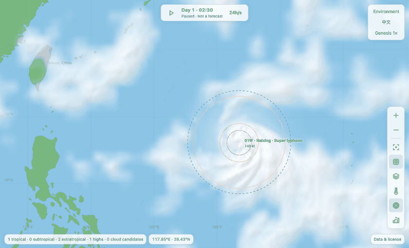
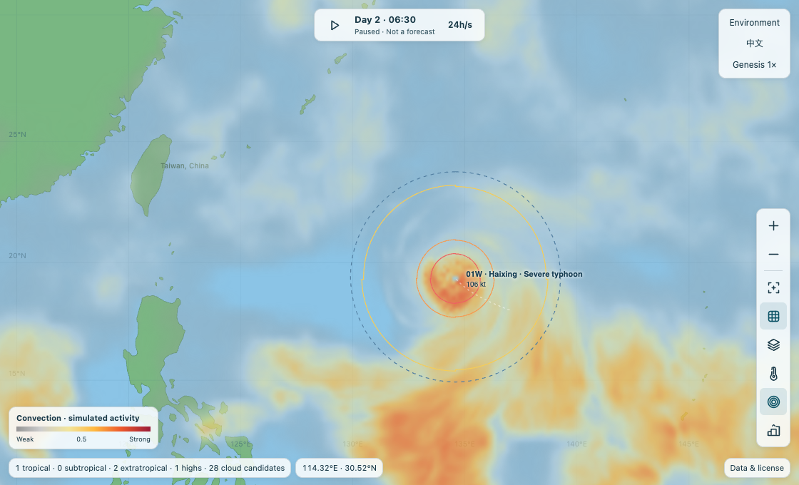
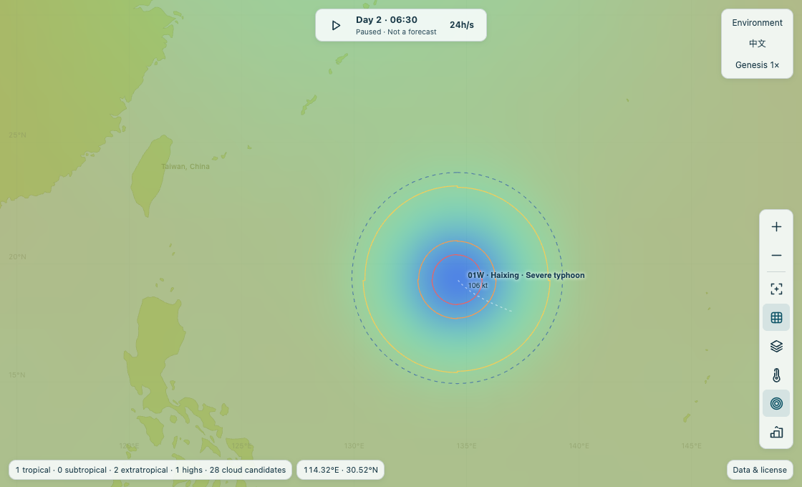
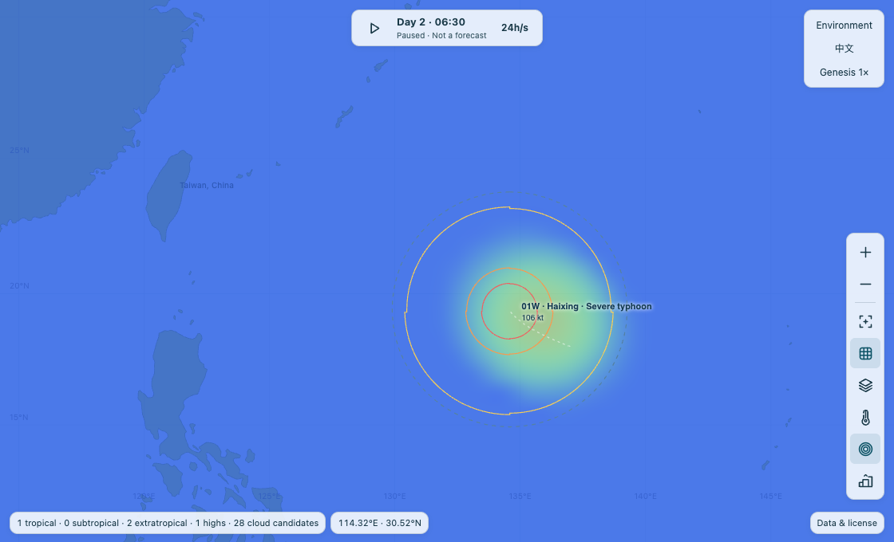
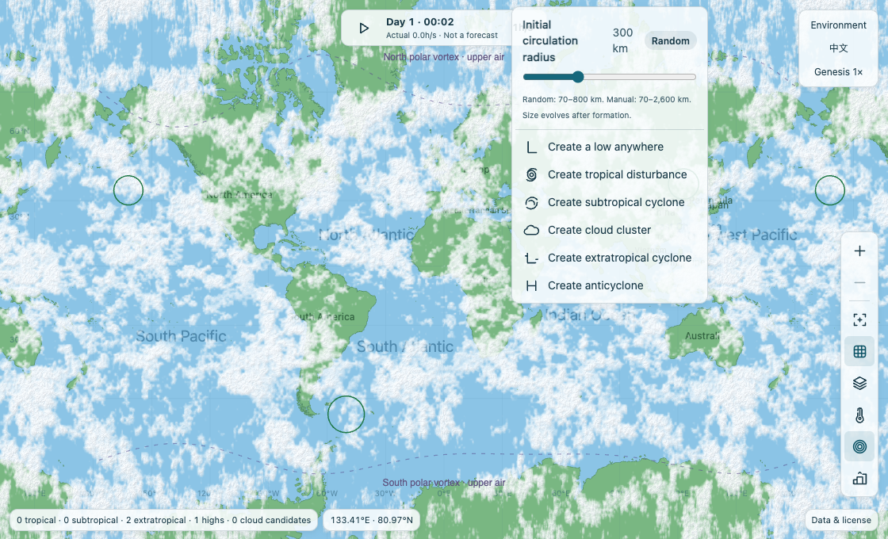
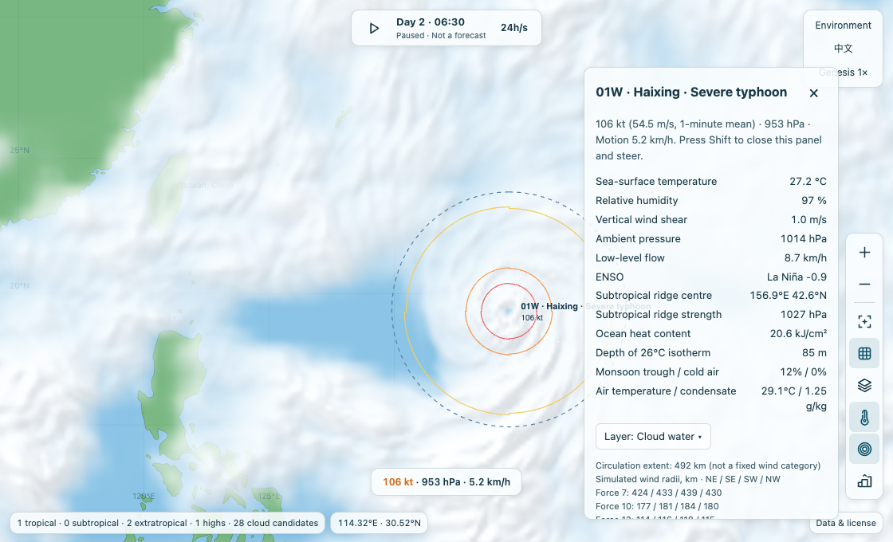
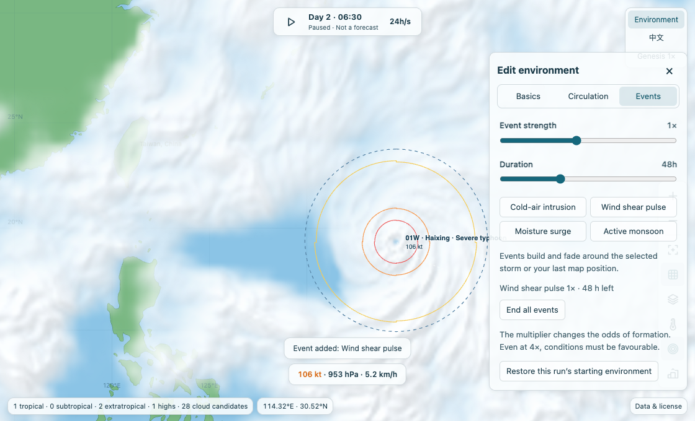

# Typhoon Simulator · Demonstrations / 演示图册

[English README](../README.md) · [中文 README](../README.zh-CN.md) · [中文操作步骤](#中文)

## English

Three experiments to try on a local run:

1. **Create and inspect.** Click an empty part of the ocean, leave the initial circulation radius on **Random** or set it yourself, then choose **Create tropical disturbance**. Click the system once it is visible to inspect its wind and pressure. This does not steer it: **Shift** starts steering and **Esc** releases it. Turn the wind rings off and on to see what the outlines add to the cloud image.
2. **Read the storm without advancing time.** Pause an established storm and keep the map still. In **Map layers**, switch between **Convection**, **Pressure · cyclones and highs** and **Cold wake · 0–6°C**. The first locates active condensation; the second locates the modelled pressure minimum; the third records ocean cooling accumulated along the track. The three features need not be centred on the same pixel.
3. **Change the environment.** In **Environment → Events**, choose a duration and strength, then click **Wind shear pulse**. The panel lists the active event and its remaining simulation time. Resume if paused, then inspect **Wind shear** and **Convection** as the event develops. The button starts a time-dependent forcing; it does not instantly redraw a broken eye.

The time lapse below uses seed 117 and a mature vortex initialised at 137°E, 18°N with a 415 km circulation radius. It samples eight frames four simulated hours apart with a fixed camera. The three diagnostic images below it come from **one paused state at the end of that sequence**, after re-centring the view. A normal launch randomises the environment, so the steps reproduce the experiment, not that exact track. None of these images is a satellite observation.

## 中文

可以在本地试这三个实验：

1. **生成和查看。** 单击海面空白处，保留「随机」环流半径或自己指定，再点「生成热带扰动」。等系统在地图上可见，点它查看风速和气压。这一步不改变路径；按 **Shift** 才开始干预，按 **Esc** 退出。开关风圈，可以分清云的边缘和风的范围。
2. **暂停，比对同一时刻。** 选一场已发展的风暴，暂停并保持视角不动。在「地图显示类型」依次选择「对流云图」「气压（含气旋与高压）」「冷尾迹降温」。三幅图分别回答：哪里还在凝结？低压中心在哪里？哪些海水曾受到搅动？三个中心不必重合。
3. **施加一次风切变事件。** 在「环境设置 → 事件」选好持续时间和强度，点击「强切变脉冲」，面板会列出剩余模拟时数。继续运行后，对照风切变图与对流图。按钮改变的是一段时间内的环境条件，不会在点击瞬间把风眼改画成另一种形状。

下方延时使用种子 117，从东经 137°、北纬 18°、环流半径 415 km 的成熟涡旋起步，固定镜头，每隔四个模拟小时取一帧，共八帧。紧随其后的三张诊断图在延时结束后重新居中，**暂停于同一时刻、使用同一视角**。普通开局会随机生成环境，可以复现观察方法，不会得到一模一样的路径。所有图像都是模拟器实截，不是卫星实况。

### Track and cloud bands / 路径与云带

### Three views of one instant / 同一时刻的三张诊断图

Click a thumbnail for the original. / 点击缩略图可打开原图。

| Convection / 对流 | Surface pressure / 海平面气压 | Ocean wake / 海面冷尾迹 |
| :--: | :--: | :--: |
|  |  |  |

### Controls in use / 操作实录

| Set the initial radius / 选择初始半径 | Read a storm / 查看风暴 | Start a shear pulse / 启动风切变脉冲 |
| :--: | :--: | :--: |
|  |  |  |
